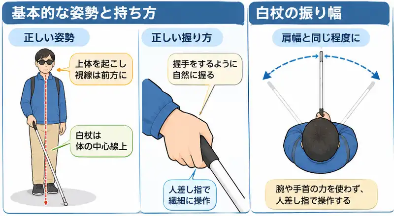
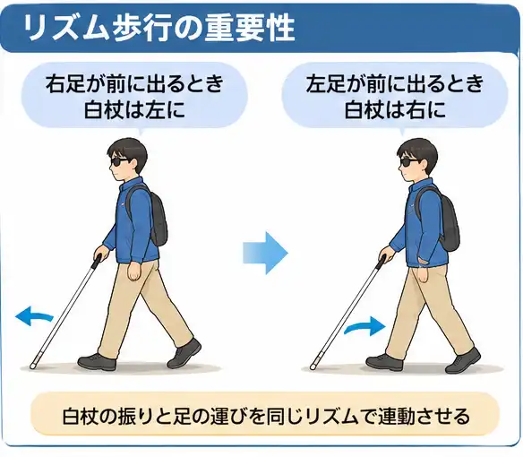
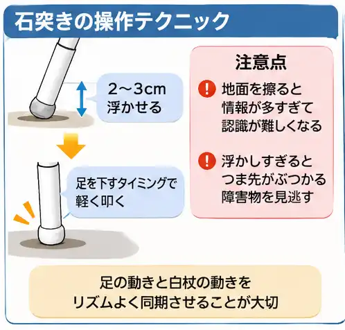
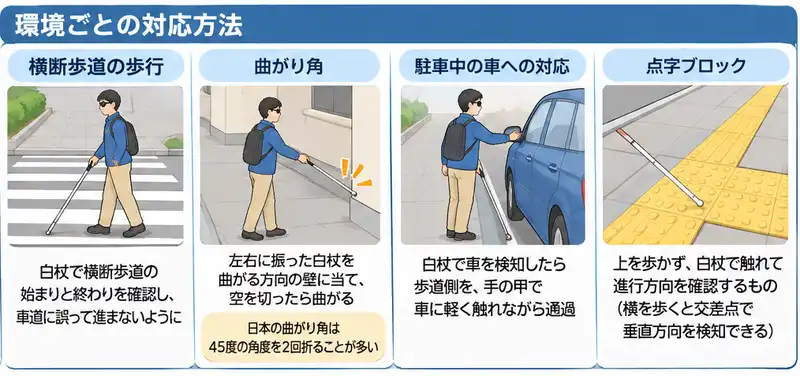

## 記事の概要

私は視覚障害1年生。日常生活における不便を解消するために、障害者向けの福祉サービスを利用して自立訓練（生活訓練）を受けることにした。本記事はその過程を記録したものである。

前回の記事では、障害福祉サービスを利用するにあたり必要となる受給者証が手元に届いた話を記録した。

* 前回の記事: [障害福祉サービス 自立訓練（生活訓練）の記録 003 【受給者証が届く】 - neputa note](https://www.neputa-note.net/entry/2026/10/30/independence-training-log-003)

今回は、白杖歩行訓練の初日の様子と、訓練前に行った契約について記録する。

[:contents]

## 自立訓練（生活訓練）利用契約

受給者証の期限は1年間であり、その間に私が希望した訓練は主に以下の通りである。

* 白杖歩行
* スクリーンリーダーによるPC操作
* 点字による読み書き

現時点では、いずれも日本点字図書館（以降、点字図書館）が提供する訓練プログラムを利用する予定である。

訓練を開始する前に、利用契約を結ぶ必要があった。

### 持参したもの

* 受給者証
* 印鑑
* 緊急連絡先（私の場合は妻の連絡先）

身体障害者手帳は、初回の面談時に提示済みであったため、今回は使用しなかった。

### 契約関連書類について

契約締結にあたり用意された書類は以下のとおりである。

* 利用契約書
* 重要事項説明書
* 個人情報保護方針

職員の方が、重要事項説明書を中心に丁寧な説明をしてくださった。障害関連の項目は、福祉サービス契約固有の内容であったが、特に理解が難しいものではなかった。

私が行ったのは以下のとおりである。

* 各書類への署名
* 各書類への捺印
* 緊急連絡先の記入（私の場合は妻の連絡先を記入）
* 受給者証の提示（内容を確認してもらい、コピーを取ってもらった）

点字図書館の職員は、視覚障害者のガイドに手慣れている。分かりやすくガイドしていただき、スムーズに手続きを行うことができた。

## 白杖歩行訓練 初日

契約手続きが無事に終わったあと、早速、歩行訓練士の方と対面し、簡単な自己紹介と訓練の流れの説明を受けた。

現在の私の見え方について説明し、今後の訓練の予定や目標を共有した。本格的な訓練を受けるのは初めてであることも伝えた。

初日は、点字図書館裏の安全な場所で、白杖の持ち方や基本的なリズム歩行の練習を行った。

これまで、断片的な知識を頼りに我流で白杖を振って歩いていたが、専門家の説明はどれもわかりやすく、先人たちの蓄積によって体系化された技術であることが理解できた。

忘れないように、訓練で学んだメモを以下にまとめる。画像はいずれも文章をもとにChatGPTで生成したイラストである。

### 基本的な姿勢と持ち方

白杖を効果的に使うためには、正しい姿勢と握り方が基本となる。グリップは握手をするように自然に握り、白杖を体の中心線上に置くことが重要である。同時に上体を起こし、視線を前方に向けることで、白杖の感覚と視覚情報を統合できるようになる。

白杖の先端を左右に振りながら歩行する際、腕や手首の力は使わず、人差し指で繊細に操作することがポイントだ。振る幅は自分の肩幅と同じ程度に保つことで、自分の体が障害物にぶつからないようにすることができる。

### リズム歩行の重要性

白杖の振りと足の運びは、通常の歩行と同じリズムで連動させることが基本である。右足が前に出るときは白杖は左、左足が前に出るときは白杖は右に振る。この左右関係を維持することで、白杖で安全を確認した場所に足を運ぶことができるのだ。リズムを刻むことで、無意識に歩行を進める技術が身に着きやすくなることも、訓練士から聞いた重要なポイントだった。

### 石突の操作テクニック

石突の扱いは、一見すると単純だが、実は非常に奥深い技術である。石突は地面を擦らず2～3cm浮かせて左右に振り、足を下すタイミングに合わせて地面を軽く叩く必要がある。常に地面を擦ると、白杖を通じて過分に情報が入ってしまい、かえって認識を困難にしてしまう。一方、石突を浮かせすぎると、つま先がぶつかる高さの障害物を見逃してしまう。このバランスを取りながら、足の動きと白杖の動きをリズムよく同期させることが、習熟への道のりだ。

### 環境ごとの対応方法

#### 横断歩道の歩行

横断歩道では、白杖を地面に軽く触れさせながら歩行する。車道に誤って進んでしまわないよう、白杖で横断歩道の始まりと終わりを確認することが重要である。よくあるのは、歩道と横断歩道の境目にある段差を白杖で検知し、横断歩道の存在を認識する方法だ。

#### 曲がり角

曲がり角では、左右に振る白杖を曲がる方向の壁に当てながら進行し、白杖が空を切ったら曲がるタイミングであることを認識する。興味深いことに、日本の曲がり角は見晴らしを良くするため、直角ではなく45度の角度を2回折る形になっていることが多いそうだ。

#### 駐車中の車への対応

進路上に車が止まっている場合、白杖で車の存在を検知したら、できるだけ車道ではなく歩道側を、手の甲で車に軽く触れながら通過する。これにより、車の位置を確認しながら安全に通り抜けることができる。

#### 点字ブロック

点字ブロックの使い方について、新たな認識を得た。点字ブロックは上を歩くのではなく、白杖で触れながら進行方向を確認するためのものである。実は点字ブロックの上は雨の日はすべりやすいなど歩きづらい。むしろ点字ブロックの横を歩くと、点字ブロックが交差する地点で、垂直方向の誘導ブロックを白杖で検知することができるのだ。

## まとめ

初日の白杖歩行訓練を通じて、基本的な姿勢や持ち方をはじめ、点字図書館の周囲を実際に歩行しながら様々な技術や注意点を学ぶことができた。

専門家の指導のもとで体系的に訓練を受けることにより、これまで我流で行っていた歩行がより安全で効率的になることを実感した。一つ一つの動作の意味を理解しながら身につけることが、習熟への近道であると感じた。

白杖歩行訓練は3か月を予定している。どこまで習熟できるかは未知数であるが、日々の訓練を通じて見えていた頃と同じように、いやできればそれ以上に自立して歩けるようになりたいと考えている。

本気で取り組むつもりである。
